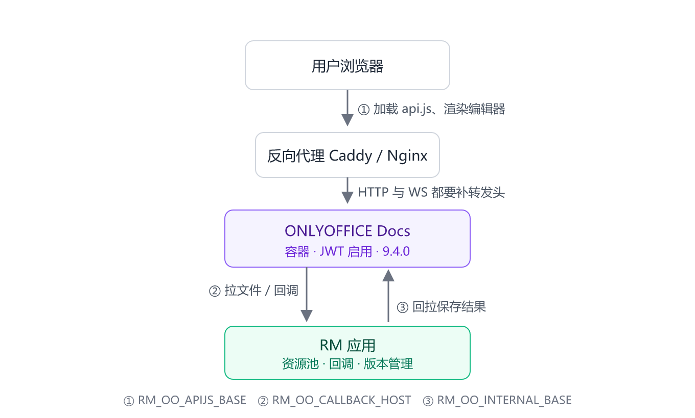
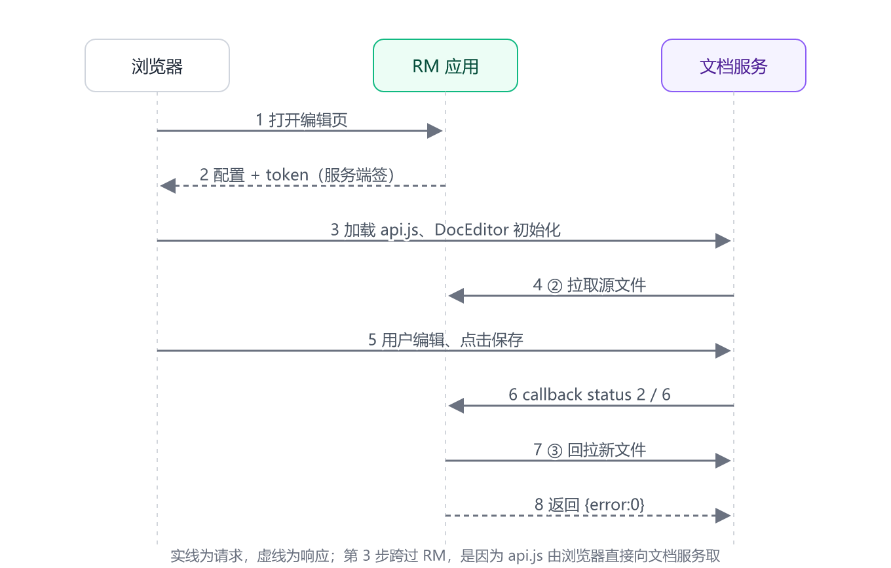

# 给自托管资源库接上在线文档编辑：ONLYOFFICE 落地与许可边界

> 本文是 RM 架构系列的第三篇。前两篇讲 RM 自己存管的资源，这一篇补上文档：Word / Excel / PPT / PDF。渲染和编辑 Office 文件这件事 RM 做不到，必须交给外部服务，于是第一次出现「运行时同步依赖一个不归它管的组件」，以及随之而来的地址、密钥与许可问题。
>
> 术语沿用前两篇（`rid` / `body_key8` / 入池路由 / 回收站）；本篇新增两个词：三个入口、版本历史。媒体库从三个 tab 变成四个。许可部分只讲工程视角的事实，不构成法律意见。

---

## 0. 结论先行

如果你只想判断要不要接，先看这张表：

| 问题 | 结论 |
| --- | --- |
| 社区版能免费用吗 | 能。AGPLv3，自托管、不修改、不分发即可长期使用 |
| 接入难吗 | 装不难，难在地址规划。文档服务与你的系统之间有 3 个方向的互访，混用一个地址必然失败 |
| 最大的坑是什么 | JWT。7.2 起默认开启，密钥不固定就会“今天好好的，重建容器后白屏” |

## 1. 场景：文档库为什么需要在线编辑

自托管资源库做到一定阶段，会遇到同一类需求：

- 同事把 Excel 传进资源池，你只能只读预览——能看，不能改；
- 想改就从本地下载、用 Office 打开、改完再传一份上去；
- 传完发现两份同名文件都在列表里，谁也说不清哪份最新。

这条链路是把版本管理外包给了人。

在线编辑要解决的是三件事：

1. 改完直接落库，不再有本地副本；
2. 每次保存自动留历史版本，能回退；
3. 删除时它是一个文件，而不是七个版本让你逐个勾选。

## 2. ONLYOFFICE Docs 是什么，三个版本怎么选

ONLYOFFICE Docs 是一套可自托管的在线办公套件（文档 / 表格 / 演示 / PDF / 表单），原生支持 OOXML（`.docx` / `.xlsx` / `.pptx`）。对国内用户比较友好的一点是格式兼容性做得不错，打开复杂表格不容易跑版。

它不是一个完整的协作平台，而是一组编辑器。文档从哪来、存到哪、谁能看，全部由你的系统决定。这是它能嵌进任何系统的原因。

三个版本先分清：

| 版本 | 镜像 | 许可 | 适合谁 |
| --- | --- | --- | --- |
| Community（社区版） | `onlyoffice/documentserver` | AGPLv3 + 附加条款 | 自用、内部系统、开源项目集成 |
| Enterprise（企业版） | `onlyoffice/documentserver-ee` | 商业许可 | 要官方支持、集群、安全补丁优先 |
| Developer（开发者版） | `onlyoffice/documentserver-de` | 商业许可 | 把编辑器打进自己的产品，打自己品牌卖给客户 |

大多数技术团队需要的是第一行。第三行是「做成 SaaS 卖给别人」时才该看的。

### 2.1 20 并发限制已经取消

如果你搜到「社区版最多 20 个同时连接」，那是旧结论。

9.4 之前（含我们实测用的 9.1.0），社区版限制 20 个并发连接，超限后新打开的文档变成只读。计数单位是「打开的文档标签页」，一个文档被两个人打开算两个连接。

9.4 起（2026 年 5 月），官方取消了这一限制，同时去掉了代码压缩、把架构合并为单进程、移除了 RabbitMQ 与数据库依赖，社区版在低配机器上跑得更轻。

所以部署前先看清版本号。文章里写「无限制」，你拿 9.1 的镜像去跑，一样会撞到只读天花板。

## 3. 许可：AGPLv3 约束了什么

很多人对 AGPL 的印象停留在「传染性极强，碰了就得开源」。这个印象既对又不对。

### 3.1 三条实质义务

| 义务 | 触发条件 | 要做什么 |
| --- | --- | --- |
| 提供源码 | 分发（把镜像/二进制给别人） | 随分发提供完整对应源码，或有效的书面获取途径 |
| 网络服务也须提供源码 | 修改后通过网络供他人使用 | 使用者有权获取你所修改版本的源码（第 13 条，AGPL 相对 GPL 的关键增量） |
| 保留声明 | 任何分发与修改 | 保留版权与许可声明，附许可证副本 |

关键在第二行：它约束的是修改版，不是使用者。

### 3.2 9.4 追加的附加条款

AGPLv3 第 7 条允许在原许可上追加少量限制。ONLYOFFICE 在 9.4 里明确追加三条，要求在所有副本与分发中一并保留：

1. 适当归属：保留对 ONLYOFFICE 的归属声明；
2. 保留版权声明：不得删除原版权信息；
3. 修改版本必须明确标注：改过就得让人看得出来。

同时明确了一句容易被忽略的话：AGPLv3 不授予商标使用权，ONLYOFFICE 商标另有单独政策。这意味着你可以说自己「基于 ONLYOFFICE 构建」，但不能把产品叫成 ONLYOFFICE，也不能用它的 logo 暗示官方背书。

### 3.3 哪些用法安全

把抽象的许可变成一张对照表：

| 你的用法 | 是否安全 | 原因 |
| --- | --- | --- |
| 自己服务器部署官方镜像，内部团队使用 | 安全 | 未修改、未分发，仅自用 |
| 部署官方镜像，给自己的客户通过网页使用 | 通常安全 | 未修改，不触发第 13 条的「修改版提供源码」 |
| 改了源码再对外提供服务 | 须开源改动 | 触发第 13 条，须向使用者提供修改版源码 |
| 把镜像打包进自己的产品，交付客户私有部署 | 须履行分发义务 | 构成分发，须提供源码与声明 |
| 打自己品牌做成 SaaS 卖给客户 | 需 Developer 版 | 官方 FAQ 明确指向开发者版 |
| 把 logo 放进宣传物料，暗示官方合作 | 不可 | 商标权不在 AGPL 授权范围内 |

我们这个项目属于前两行的组合：仓库是 Apache-2.0，只做集成客户端，既不打包容器也不分发文档服务，文档服务由使用者自行部署。所以项目本身的许可不受影响，也不承担 AGPL 的分发义务。

给同类项目的建议：把「集成代码」和「被集成的服务」在仓库层面切开。仓库里只出现接口调用与配置项，不出现 ONLYOFFICE 的任何二进制、源码或它的 `LICENSE` 文件，边界就很清楚。

### 3.4 上线前自查

把上面的内容收敛成可以直接勾选的五项，建议放进项目的部署文档：

- [ ] 仓库中不含文档服务的源码、二进制、镜像或它的 `LICENSE` 文件（只保留集成代码与配置项）
- [ ] 未修改文档服务源码；若确有修改，改动已公开，并在界面标注「已修改」
- [ ] 对外文案与界面未使用 ONLYOFFICE 商标、Logo 暗示官方合作
- [ ] JWT 密钥、签名密钥只存在于环境变量或未入库的 env 文件
- [ ] 若以自己品牌对外提供该能力，已确认是否需要 Developer 版商业许可

## 4. 架构：三个入口必须分离

同一个文档服务在三个方向上被访问，而这三个方向的可达性完全不同：

| 方向 | 谁 → 谁 | 典型地址形态 | 用途 |
| --- | --- | --- | --- |
| ① 浏览器 → 文档服务 | 用户浏览器 → 公网反代 | `https://<文档服务公网入口>` | 加载 `api.js`、渲染编辑器 |
| ② 文档服务 → 你的系统 | 容器 → 宿主 | `http://<宿主可达地址>:<端口>` | 拉取待编辑文件、回传保存结果 |
| ③ 你的系统 → 文档服务 | 宿主 → 回环 | `http://127.0.0.1:<回环端口>` | 保存时回拉文件内容 |



为什么不能混用一个地址：

- 方向 ① 必须是浏览器能解析、证书有效的地址。填容器名 `onlyoffice-documentserver`，浏览器根本不认识。
- 方向 ② 必须是文档服务容器能访问到宿主的地址。填 `127.0.0.1`，指的是容器自己。
- 方向 ③ 是反过来的：宿主回拉容器，需要一个只绑在本机的端口。

实践中三条配置长这样（占位符）：

```
浏览器入口：https://docs.example.com
文档服务反连宿主：http://<宿主在容器网络中的地址>:<应用端口>
宿主回拉文档服务：http://127.0.0.1:<回环端口>
```

方向 ③ 的那个端口只绑本机，绝不对外：

```bash
-p 127.0.0.1:8082:80
```

注意：`127.0.0.1:<回环端口>` 能生效的前提是你的应用与文档服务共享宿主网络命名空间。如果应用跑在 bridge 网络里，这个地址会失效，得换成宿主在桥接网里的地址。症状很迷惑：编辑器能打开、页面也正常，就是一点保存就报下载失败。

### 4.1 baseurl 是协商出来的

文档服务生成文件下载地址时，用的不是你配置的地址，而是从连接里推断出来的 `baseurl`，依据是反向代理传过来的 `X-Forwarded-Host` 与 `X-Forwarded-Proto`。

关键在于编辑器加载走 WebSocket，而很多反代只在 HTTP 链路上补了转发头，WS 那条没补。结果文档服务在 WS 上推断不出公网域名，回退成容器名，浏览器解析不了，弹 `Download failed.`。

排查方法：看文档服务日志里的 `baseurl`。等于公网入口说明转发头正常；等于容器名（如 `onlyoffice-documentserver`）说明 WS 链路的转发头没补。

## 5. 部署文档服务

社区版部署不复杂，关键是固定 JWT 密钥：

```bash
docker run -d --name onlyoffice-documentserver \
  --restart unless-stopped \
  -p 127.0.0.1:8082:80 \
  -e JWT_ENABLED=true \
  -e JWT_SECRET='<与你的应用完全一致的固定密钥>' \
  onlyoffice/documentserver:9.4.0
```

三个参数各有讲究：

`JWT_ENABLED=true` 与 `JWT_SECRET` 必写。从 7.2 起 JWT 默认开启并自动生成随机密钥。不显式指定的话，容器每次重建就换一个新密钥，而你的应用还在用旧密钥签名，现象是「昨天还能编辑，今天打开白屏」。

端口只绑回环。`127.0.0.1:8082:80` 供方向 ③ 使用，不要写成 `8082:80` 对外裸奔。对外统一走反代，在反代上做登录与授权。

版本号写死，别用 `latest`。9.4 前后社区版的行为差异不小，生产环境要能复现。

### 5.1 反代要补的头：HTTP 与 WS 两条链路

以 Nginx 为例，最小可用片段：

```nginx
server {
    listen 443 ssl;
    server_name docs.example.com;

    location / {
        proxy_pass http://127.0.0.1:8082;
        proxy_http_version 1.1;

        # 让文档服务知道外面的人是通过哪个地址访问它的
        proxy_set_header Host              $host;
        proxy_set_header X-Forwarded-Host  $host;
        proxy_set_header X-Forwarded-Proto $scheme;
        proxy_set_header X-Forwarded-For   $proxy_add_x_forwarded_for;

        # baseurl 在 WS 这条链路上被推断，缺了这两行前面的头全白设
        proxy_set_header Upgrade    $http_upgrade;
        proxy_set_header Connection "upgrade";

        # 大文档的保存与下载别用默认 60 秒
        proxy_read_timeout 3600s;
        proxy_send_timeout 3600s;
        client_max_body_size 100m;
    }
}
```

常见遗漏按出现频率排序：

1. 只配了 `Host`，没配 `X-Forwarded-Host`：文档服务认的是后者；
2. 漏了 `Upgrade` / `Connection`：WS 握手失败，编辑器功能残缺，或 `baseurl` 退回容器名；
3. 超时用默认值：小文档一切正常，几十 MB 的表格一保存就断，看着像偶发问题。

用 Caddy 会省事不少：它默认补 `X-Forwarded-*` 并自动处理 WebSocket 升级，通常只需要一句 `reverse_proxy 127.0.0.1:8082`。这也是本项目生产环境选它的原因之一。

## 6. 在你的系统里启用

以本项目的实现为例，启用与否完全由环境变量控制，默认关闭。关闭时前端没有入口，相关接口统一返回 404，不接文档服务也能独立跑起来。

六个变量，按「三个入口 + 两个密钥 + 一个开关」记：

| 变量 | 作用 | 说明 |
| --- | --- | --- |
| `RM_OO_ENABLED` | 总开关 | 默认 `false`，设 `1` 开启 |
| `RM_OO_JWT_SECRET` | 编辑器 JWT 签名密钥 | 必须与文档服务的 `JWT_SECRET` 完全一致 |
| `RM_OO_SIGN_SECRET` | 短期票签名密钥 | 用于文件/回调 URL；留空会回退并可能每次启动随机，生产必须固定 |
| `RM_OO_APIJS_BASE` | 方向 ① 公网入口 | 浏览器侧加载 `api.js` 用 |
| `RM_OO_CALLBACK_HOST` | 方向 ② 反连地址 | 文档服务回调你系统时用 |
| `RM_OO_INTERNAL_BASE` | 方向 ③ 内部入口 | 保存时回拉文件用 |

密钥只走环境变量，不进 `config.json`，更不进仓库。建议单独放一个 `600` 权限的 env 文件，启动时 `--env-file` 读入。

一个容易踩的运维细节：**`docker restart` 不会让容器读到新增的环境变量**，必须停旧容器、按新参数重建。我们第一次启用就卡在这里，env 文件写好了，`restart` 一按，前端还是没入口。

## 7. 编辑器配置与 JWT 签发

编辑器不是引入一个 iframe 那么简单，它需要一份配置，并且必须带签名。

### 7.1 配置的最小结构

```json
{
  "documentType": "cell",
  "document": {
    "fileType": "xlsx",
    "key": "<rid>_v<版本号>",
    "title": "2026年收到发票记录表",
    "url": "https://<你的系统>/api/oo/file?rid=...&email=...&exp=...&sig=...",
    "permissions": { "edit": true }
  },
  "editorConfig": {
    "callbackUrl": "https://<你的系统>/api/oo/callback?key=...&email=...&exp=...&sig=...",
    "user": { "id": "user@local", "name": "user@local" },
    "customization": { "autosave": false }
  }
}
```

四个字段值单独说：

`key` 决定协作会话与缓存，内容变了必须变。这是最容易出错、症状又最诡异的一个字段。文档服务用 `key` 标识「这是哪一份文档的哪个版本」。如果内容更新了但 `key` 没变，文档服务认为还是同一份，直接从缓存里给你旧内容，用户会看到自己刚保存的修改消失了。

本项目用 `key = <rid>_v<版本号>`：`rid` 是内容哈希（同一份文档的稳定标识），版本号每次保存递增。内容变则版本变、`key` 变，缓存自然失效。

`url` 由文档服务来拉文件，但它不带任何身份信息。这点很关键：文档服务去 `url` 取文件时是一个干净的 HTTP 请求，没有 cookie、没有你的登录态、没有身份头。所以「谁能取这个文件」必须编码在 URL 里并用签名保护，否则任何人猜到 `rid` 就能下载别人的文档。

本项目把 `rid` 和身份一起签进 `sig`，改 `email` 会验签失败，不存在越权读取。

`callbackUrl` 同理，身份与签名要放在 query 上。

`autosave: false` 让保存时机可控。关掉自动保存后，只有用户主动保存才落一个新版本。否则每隔几秒就派生一个版本，版本历史会被刷成噪声。

### 7.2 JWT 在服务端签发

完整流程：服务端生成配置对象，用 `RM_OO_JWT_SECRET` 做 HMAC-SHA256 签名，把配置与 token 一起注入页面，前端用 `DocsAPI.DocEditor` 初始化。

```python
config = {
    "documentType": doc_type,
    "document": {"fileType": ext, "key": key, "title": title,
                 "url": file_url, "permissions": {"edit": True}},
    "editorConfig": {"callbackUrl": cb_url,
                     "user": {"id": sid, "name": sid},
                     "customization": {"autosave": False}},
}
token = jwt_encode_hs256(config, OO_JWT_SECRET)   # 服务端签名
```

页面侧只要两行：

```html
<script src="https://<文档服务公网入口>/web-apps/apps/api/documents/api.js"></script>
<script>
  var cfg = /* 服务端注入的配置 */;
  cfg.token = /* 服务端注入的 token */;
  new DocsAPI.DocEditor("editor", cfg);
</script>
```

token 由服务端签发后下发，密钥本身永不出现在浏览器。把密钥写进前端 JS 自己签，等于把钥匙挂在门上。

顺带一句：JWT 模式下任何拿到密钥的人都能签出合法 token。密钥属于部署机密，不能写进代码、不能提交进仓库、不能出现在前端页面里。

### 7.3 那个 150px 的坑

编辑器打开后只显示一条细缝，下面一片空白。这几乎是每个人都会遇到一次的经典问题。

原因：`api.js` 会把它占位的 `div` 替换成一个 `<iframe height="100%">`，并直接挂在 `<body>` 下。如果你只给 `#editor` 设了高度，`<body>` 是自动高度，iframe 的 `100%` 无处可依，就退回默认的 150px。

修法只有一个方向：把高度一路给到 `html` 和 `body`。

```css
html, body { margin: 0; height: 100%; }
#editor { width: 100%; height: 100%; }
```

## 8. 回调保存

编辑完点击保存，文档服务会向 `callbackUrl` 发一个 POST。这一步有几个硬性约定，错一个就保存静默失败。



### 8.1 只处理 status 2 和 6

| status | 含义 | 处理 |
| --- | --- | --- |
| 1 | 正在编辑 | 忽略 |
| 2 | 所有人关闭文档，可以保存 | 落盘 |
| 3 | 保存出错 | 忽略并记日志 |
| 6 | 强制保存（编辑中也需要落） | 落盘 |

只处理 2 和 6，其余原样返回 `{"error": 0}`。

### 8.2 必须返回 0，否则编辑器认为保存失败

无论你内部成功还是失败，**HTTP 响应必须是 `{"error": 0}`**。返回非 0 或 500，编辑器会弹「保存失败」，用户以为内容丢了。真实错误写进自己的日志，别通过这个响应体表达。

### 8.3 参数在 query 上，不在 body 里

> 文档服务回调时，是把 `callbackUrl` 原样 POST。body 里只有 `status`、`url`、`key` 这些编辑器字段；你在 `callbackUrl` 上带的 `email`、`exp`、`sig` 不会进 body。

所以身份和签名必须从 `request.query_params` 读。我们最初只读 body，结果 `owner` 恒为空，保存请求全部被静默丢弃，日志里看不到任何异常，只有「保存了但没变」。

### 8.4 三道闸门 + 幂等

一个可靠实现至少要有：

1. 验签：`sig` 必须能通过，且把 `key` 与身份一起绑进签名；
2. 主机白名单：回调里的下载地址必须属于你信任的网段/域名，防止被诱导去拉任意 URL；
3. `key` 幂等：同一个 `key` 只落盘一次，避免网络重试导致重复派生版本。

加上这三道，回调才算能上生产。

### 8.5 回写：拉回来，派生新版本

处理流程：

1. 从回调里取出文件下载地址；
2. 以你的系统身份回拉（这就是方向 ③ 的用途）；
3. 按内容哈希入池，派生出一个新版本；
4. 把当前版本指针指向新文件。

第 3 步不是覆盖原文件，这与下一节的版本管理直接相关。

## 9. 版本管理：`rid` 是一个逻辑文件

在线编辑天然会产生多版本。直觉做法是每次保存生成一个新文件、旧的进回收站。用起来会很快崩掉：

- 回收站被版本塞满，真正的「已删除文件」反而找不到；
- 用户看到列表里同一份文档有七个条目，不知道点哪个；
- 删除一次只删掉一个版本，剩下的还挂在列表里。

正确的模型是**一个逻辑文件对应一个 `rid`，多版本只存在于后端**。

| 维度 | 设计 |
| --- | --- |
| 前端 | 只显示、只编辑一个当前版本，用户感知不到多版本 |
| 版本历史 | 存在后端状态文件里，可查看、可下载任意版本、可设为当前 |
| 回滚 | 只切换指针，不复制文件、不新增条目 |
| 删除 | 按 `rid` 整体删除，所有版本一起处理 |
| 回收站 | 旧版本不进回收站，它是文件内部历史，不是被删除的文件 |

这个模型带来两个好处：回滚零成本，不产生新文件；版本号单调递增，回滚后继续编辑版本号接着往上走，不会与历史编辑会话冲突（否则 `key` 可能撞上旧值，编辑器又读到缓存）。

### 9.1 对上一篇的一处修正

《从视频池到双资源》讲图文编辑时，写的是「保存时复用原 `resource_id` 更新当前版本，旧版本按既有机制进回收站」。

文档这条线做完之后，这个说法需要限定范围。系统里目前有两套版本语义：

| 资源 | 保存后的旧内容去哪 | 用户在哪里看到 |
| --- | --- | --- |
| 图文 | 旧的 `body_key8` 子目录，登记进回收站（可还原） | 回收站列表 |
| 文档 | `version_log` 里的一条记录，不进回收站 | 文档卡片的版本历史 |

改的原因不是回收站不好用，而是它装错了东西。

回收站是管理员视角的删除区，躺在里面的是「用户以为已经删掉的东西」，语义是「我不要了」。而旧版本是「用户还想要、只是被新版本取代」的内容。两者塞进同一个列表，结果是回收站堆满没人想恢复的快照，真正的误删反而找不到。

所以文档换了一套语义：版本历史按 `rid` 组织、只切指针、保留版本号；回收站仍是按引用计数触发的管理员区。

需要如实说明：这两套语义目前并存，不是有意设计成两种，而是图文那条链路先落地、文档这条后做。要不要把图文也收敛到版本历史是个明确的待办，技术上不难（`version_log` 本身与资源类型无关），但要先确认图文的旧版本没有被其他链路依赖，否则等于在移动承重墙。

## 10. 排障清单

遇到问题先查这里：

| 现象 | 根因 | 详见 |
| --- | --- | --- |
| 弹 `Download failed.` | 推断出的 `baseurl` 是容器名，WS 链路没补转发头 | 4.1 |
| 同一个报错，但页面其余正常 | 方向 ③ 的回环地址失效（应用不在 host 网络） | 4 |
| 编辑器白屏 / token 错误 | 两侧 `JWT_SECRET` 不一致，或容器重建后密钥被重新随机 | 5、7.2 |
| 编辑器只有 150px 高 | `html` / `body` 没给高度 | 7.3 |
| 打开编辑页 403 | 前置反代白名单没放行编辑路由前缀 | 5.1 |
| 保存后内容没变、日志还正常 | 回调里 `owner` 为空（只读了 body） | 8.3 |
| 保存后重开是旧内容 | `key` 没随内容变化，编辑器命中缓存 | 7.1 |
| 编辑到一半突然变只读 | 社区版 9.4 之前的 20 并发限制 | 2.1 |

## 11. 验证清单

部署完成后按四步走一遍，能覆盖绝大多数问题：

1. 新建任一类型文档，资源池出现条目，文件名是标题而不是哈希；
2. 打开编辑页，编辑器铺满容器，无下载失败弹窗；
3. 编辑并保存，后端日志出现回写记录，条目指向新版本；
4. 关闭重开，内容仍在；点版本历史能看到两个版本且能回滚。

四步全过，这条链路就算通了。

## 12. 小结

许可上，社区版 AGPLv3 足够自托管使用，边界是三条线：不修改就不用担心第 13 条，不分发就不用担心分发义务，不打自己品牌卖就不用担心开发者版。9.4 的附加条款只要求保留归属、保留版权、标注修改、不用商标，不难做到，但必须做到。

工程上，坑集中在两处：三个方向的地址规划，和 JWT 密钥的稳定性。两者配错，报错都表现为网络问题，很容易在不相关的地方耗掉半天。

设计上，多版本不要交给回收站。把「一个文件」和「它的历史」分开建模，前端只认当前版本，回滚只切指针。图文那条线目前还是旧语义（见 9.1）。

另外提醒一句：社区版不含官方技术支持，出问题只能靠日志与社区。生产环境要把日志留存、版本号、配置基线都管起来，否则排障成本会远高于许可费用。

最后一件事：ONLYOFFICE 迭代很快，社区版的架构与许可条款在 9.4 有过一次明确调整。写进部署文档的版本号，比任何博客标题都可靠。
