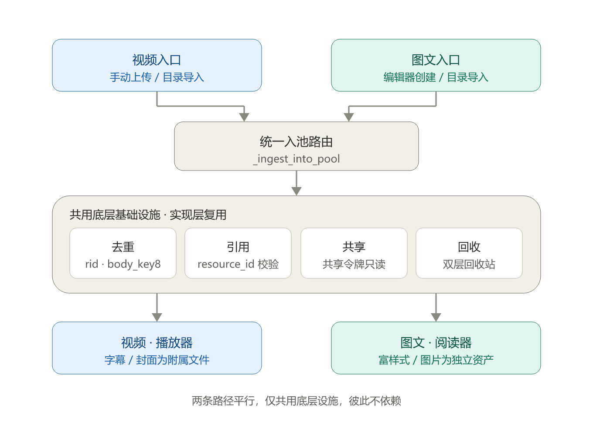

# 从视频池到双资源：RM 新增图文一等资源管理

> 这篇只回答一个问题：在一个已经跑通的资源池模型上，图文能不能拿到与视频同等的一等身份。

本文是开源项目 media-resource-manager（简称 RM）架构系列的续篇，面向想了解或复用该设计的开发者。上一篇《媒体资源池与回收站》介绍了管理层的核心模型：内容级去重、双层回收站、合集引用、按身份的共享失效。那一篇的主角是视频，以及字幕、封面这些围绕视频的衍生附件；图文只作为「文章衍生物」被一句话带过。

---

## 0. 这一篇补上什么

上一篇里的图文只有一条来源：从字幕经大模型生成，以 Markdown 挂在视频旁。它依附于某个视频，没有自己的 `resource_id`，不进池，不参与去重与共享，也无法手写。

这一篇新增的是一套独立的图文资源管理扩展，不是把视频的附属产物升级成图文：图文拥有自己的 `resource_id`，独立入池、独立管理，系统内可直接写、可编辑、可分类。两者并无强关联，只共用同一套底层池化机制。全文围绕四条设计约束展开。

---

## 1. 四条设计约束

| 约束 | 含义 | 带来的好处 |
| --- | --- | --- |
| 不破坏既有模型 | 图文继续走 `_ingest_into_pool`，不另起一套存储与引用机制 | 卡片、阅读器、共享、回收站全部继承，零重复实现 |
| 图文视频同路由 | 图文用与视频相同的入池、去重、回收链路，只是资源类型标识不同 | 一套代码服务两类资源，运维心智负担不翻倍 |
| 安全确定性输出 | 富文本经白名单清洗，同样的输入永远得到同样的输出 | 可缓存、可比对、可审计，不给脚本与外链留缝 |
| 创建管理闭环 | 系统内可直接写、可编辑、可分类，不依赖任何外部组件 | 任何部署都拥有一套完整可用的图文管理能力 |

四条约束里，不破坏既有模型决定了必须复用入池路由；复用入池路由让图文自然获得去重与回收能力；富文本要进这条流水线，就必须在入口完成确定性清洗；而闭环不能缺在「谁来创建」这一环，否则能力对用户不可用。

两类资源的实际差异如下。

| 维度 | 视频资源 | 图文资源 |
| --- | --- | --- |
| 主文件 | 视频文件（mp4 等） | 独立 HTML 文档 |
| 附属内容 | 字幕、封面，都是视频的衍生文件 | 图片是独立资产，可单独管理与复用 |
| 元数据 | 分集序号、标题（与图文共用去重键） | 额外带来源链接、发布日期、内容子类型 |
| 展示方式 | 播放器 | 阅读器，内联渲染并还原富样式 |
| 内容风险 | 文件本身，无富文本注入面 | 富文本 HTML，需白名单清洗与确定性输出 |
| 创建方式 | 手动上传 / 目录导入 | 系统内编辑器直接创建，也可按约定格式导入 |
| 编辑 | 不涉及正文编辑 | 统一编辑器，`rid` 复用，旧版进回收站 |
| 生命周期 | 共用去重、合集引用、回收站 | 同样共用，但图文有自己的卡片与分类 |

两类资源从各自入口进来，走同一条底层管道，彼此不依赖。整体结构如下：



下面逐项展开图文这条线是如何落地的。

---

## 2. 一等资源：让图文走同一条入池路由

关键改动只有一处：给统一的入池函数增加图文分支。无论图文来自系统内的编辑器保存，还是按约定格式经目录导入，最终都调用同一个 `_ingest_into_pool`，传入一个独立的资源类型标识。

```
前端编辑器 ─┐
            ├─> _ingest_into_pool(article) ─> resources/<rid>/<body_key8>/
目录导入 ───┘                                  └─> 合集引用 / 共享 / 回收站
```

这一处复用带来四项能力：

- **去重**：图文主文件按内容哈希派生 `rid` 与 `body_key8`，同内容不同文件名只落一份；
- **引用**：图文条目持有 `resource_id`，取流校验「该身份合集是否含此 rid」，越权同样 404；
- **回收**：删除图文只移引用，全局引用归零后进管理员回收站，整条快照可还原；
- **共享**：图文条目可被共享令牌覆盖，接收方看到的是只读渲染。

图文因此不需要任何专属的存储或权限代码，它继承的是《资源池与回收站》交付的后端基础设施。图文的卡片、详情、分类、编辑都是它自己的。

---

## 3. 数据模型扩展：四个新字段

图文分支在原有条目结构上只增加四个字段，视频条目零影响：

| 字段 | 取值 | 作用 |
| --- | --- | --- |
| `source_type` | `article` | 标识资源大类，驱动图文专属逻辑 |
| `url` | 来源链接（可选） | 详情页显示「来源」，只存不外链渲染 |
| `published_at` | `YYYY-MM-DD` | 发布日期，卡片与筛选使用；空串表示未知，不猜 |
| `content_type` | 自由文本 | 内容子类型标签（如「图文」「贴图」），由生产者填写 |

此外，图文分支把所有图片附件收集到 `images[]`，并把 `media_type` 显式覆盖为 `article`（HTML 文件的默认媒体类型是 other）。合集去重键 `(vid, seq, 标题)` 对图文同样适用，避免同一篇被重复收录导致条目翻倍。

`content_type` 刻意保持自由文本。不同来源的分类体系不同，强加枚举只会让一部分内容无法归类；空串按「未知」处理，比猜测更安全。

---

## 4. 富样式：白名单清洗与确定性输出

图文最大的技术风险是富文本本身。图文 HTML 常带着大量内联样式、图片与表格，直接存进系统等于把不可控内容引入管理层。RM 的做法是服务端白名单清洗：

```
图文 HTML
   └─ 服务端保存时：DOM 白名单清洗 → CSS 属性/值过滤 → 属性排序 → 落池
```

清洗规则有三条：

- **标签白名单**：只保留段落、标题、列表、引用、表格、图片、链接等安全标签；脚本、iframe、事件属性一律剥除。
- **CSS 属性白名单**：只放行排版类属性（颜色、边框、间距、字号等）；`url()`、`javascript:` 等危险值整条丢弃。
- **确定性输出**：保留的样式属性按键名排序后拼接。同样的输入必定得到同样的字节，便于去重哈希与事后比对。

服务端清洗器的 CSS 属性白名单最初只放行 `border-left`，漏了 `border-top` 和 `border-bottom`。用户用编辑器里的「蓝色标题」按钮生成的 `h2` 带上下横线与左竖条，保存后横线被剥掉，只剩一根竖条。修复方式是把这两个属性补进白名单，而不是放开所有 `style`。白名单方案的好处是差异可见、可查、可对齐。

「蓝色标题」按钮本身只是个样式模板，一键生成带上下横线与左竖条的 `h2`，它走的仍是同一套白名单，不绕过任何安全过滤。

---

## 5. 阅读器：一次由 iframe 引发的真实故障

图文做完、样式恢复后，出现了一个现象：文章正文和样式都正常，唯独图片全部不见了，只剩图注。

根因在鉴权拓扑。阅读器用空 `sandbox` 的 iframe 渲染正文，这是一个 opaque origin，其中的 `` 子资源请求不会携带同源的会话 Cookie。而权限网关的会话 Cookie 带有严格的跨站发送约束，于是上游鉴权先于 RM 返回未认证响应。正文导航请求按父页面 same-site 带上 Cookie 所以正常，于是出现「文字在、图没了」。

修复不动网关配置，而是在阅读器里绕开子资源请求：

```
父页面（同源、带 Cookie）
   ├─ fetch 正文 HTML
   ├─ 逐张 fetch 图片 → Blob → data: URI
   └─ 把整份文档（含 <style>）注入 srcdoc
iframe 内零网络子资源 → 不依赖 Cookie
```

这个方案保留了空 `sandbox` 的隔离强度（脚本仍被拦），自有与共享两条路径走同一逻辑，单张图失败只降级为占位而不让整篇空白。它也是后面图片资产章节里 data URI 思路的雏形，只不过那里只用于阅读展示，不用于持久化。

> 取舍记录：也曾考虑给 iframe 加 `allow-same-origin` 或修改 Cookie 的跨站属性，前者削弱隔离，后者牵动全局鉴权语义，都不如父页取图、内联注入来得局部与可控。

---

## 6. 图片资产：从内嵌到独立资产

图文的图片有两种存法，选哪种直接决定了图片能不能被管理与复用：

| 方案 | 做法 | 问题 |
| --- | --- | --- |
| data URI 内嵌 | 图片转 base64 写进 HTML | 图片失去独立身份，无法复用、无法清理，与「资产」定位矛盾 |
| 独立资产 + 引用（采用） | 图片单独存，文章用 `/api/image/<id>` 引用 | 阅读器需多识别一种 URL 前缀 |

RM 采用后者。图片落在按身份隔离的 `users/<hash>/images/` 目录，id 由内容哈希派生，文章正文只存引用。这样图片才成为可复用、可清理的独立资产。这也是图文区别于视频衍生附件的关键：视频的封面与字幕是视频的附属文件，图文的图片是独立资产。

配套三个机制：

1. **上传隔离**：每张图只进上传者的资产区，`GET /api/image/<id>` 默认只认本人；共享视图带令牌时才按令牌 owner 放行。
2. **used 按需重算**：不维护增量引用表，而在需要时扫描本人文章正文，统计被引用的图片 id 集合。图片量级（几十到几百）下全量扫描足够，避免增量双写的一致性难题。
3. **手动回收站**：系统只标记 used/unused，把 unused 图移入回收站是用户的显式动作；在用图一律拒绝清理，从根上杜绝破图。

---

## 7. 一个内容哈希引发的隔离问题

used 扫描上线后，出现了一个隐蔽的越界：图片 id 是纯内容哈希，两个用户上传同一张图会得到同一个 id。原本的 used 判定扫描全库文章，于是 A 的文章引用了该图，B 上传的同 id 图片也被标记为「使用中」，B 再也删不掉自己的图。

问题出在扫描范围。语义上，被共享文章里的图只读，不能在自己的图文里引用；编辑器插图只来自本人资产区。引用天然按 owner 发生，不存在跨用户引用，那么 used 判定也应当按人隔离，只遍历当前用户自己合集下的文章正文。

修复只改了扫描范围（增加 `sid` 参数，三处调用传入当前身份），不动存储结构、不动共享取图。验证覆盖了最关键的边界：A、B 上传同内容图得到同 id，A 引用后 A 删不掉、B 仍可清理；A 编辑文章去掉引用后，自己的图也恢复可删。

---

## 8. 图文生产闭环：系统内直接写

前面解决的是图文进来之后怎么存、怎么显示。但图文要成为独立、可管理的资源，用户必须能在系统内直接创建它，否则图文库永远是空的。所以最后一块是前端直接写图文，这让 RM 对任何部署都形成完整闭环。

设计上坚持零 CDN、零外部依赖：`contenteditable` 加 `execCommand` 实现富文本工具栏，服务端完成白名单清洗。字段与入池契约一致，保存时调用同一个 `/api/article/save`，走同一个图文入池分支。

| 环节 | 前端 | 服务端 |
| --- | --- | --- |
| 富文本编辑 | `contenteditable` + 工具栏（标题/粗体/列表/引用/代码块/图片） | — |
| 安全清洗 | 编辑态的 DOM 规范化 | 白名单清洗与确定性输出 |
| 图片 | 上传后插入 `/api/image/<id>` 引用 | 内容哈希去重、身份隔离 |
| 元数据 | 标题/日期/类型/来源/合集 | 随条目入池 |
| 落池 | POST `/api/article/save` | 复用 `_ingest_into_pool(article)` |

前端创建的图文与入池契约完全同构，自动继承卡片展示、阅读器、共享、回收站，没有一行专属代码。这是不破坏既有模型这条约束的回报。

---

## 9. 编辑能力：统一编辑器与版本回收

图文能创建之后，剩下的问题是「怎么改」。答案刻意做得简单：所有图文都在同一个编辑器里修改，保存时复用原 `resource_id` 更新当前版本，旧版本按既有机制进回收站。

能安全覆盖的前提是图片已经资产化。本地创建的图文，图片是 `/api/image/<id>` 形式的独立引用，存在按身份隔离的资产区。重存只覆盖 HTML 文件，图片文件与引用都不动，used 扫描也认这种引用，所以覆盖不会破图。图片从正文里解耦出来，正文才可以自由重写。

编辑链路有三步：

1. **加载**：按条目读回正文与元数据，剥掉重复的 `<h1>` 与 meta 段（否则保存时标题会套两层），回填标题、日期、类型、来源 URL、合集。
2. **图片呈现**：逐张取回图片并转成 data URI 塞进编辑器，与阅读器同思路，避开子资源鉴权问题。
3. **保存**：清洗后覆盖当前版本，`rid` 复用，旧版进回收站，可随时还原。

还有一处来源兼容：如果一篇导入的图文，正文里带的是相对路径图片而非资产引用，编辑保存前会把这些图片先上传成 `/api/image/<id>`、替换正文引用，再落池。这样无论图文从哪来，只要编辑过一次，落池后的存法就是统一的。归一发生在编辑保存的那一刻，是保存的副产品，不是一套迁移机制。共享文章一律只读，不提供编辑入口。

---

## 10. 分类与详情：三个 tab 与来源链接

图文成为一等资源后，媒体库里视频与图文可以并存于同一合集。界面做了三 tab 分类：全部、视频库、图文库，只做类型筛选，合集数据与下拉完全共用。实现上让网格渲染与所有卡片操作共用同一份筛选列表，卡片下标自然对齐，避免筛选后点开错条目；播放页 URL 携带当前 tab，保证新标签页里索引仍指向同一条。

详情页补了两处：一是「蓝色标题」等富样式在阅读器中完整还原（见 §4），二是来源 URL 以「来源：链接」形式显示，仅放行 http/https、新标签打开并加 `noopener`，字符转义防注入。共享视图因令牌不回传该字段，暂不展示，这是数据契约的边界。

---

## 11. 能力清单更新

在上一篇的清单上，图文相关能力补齐如下：

| 能力 | 说明 |
| --- | --- |
| 图文一等资源 | 独立 `resource_id`、独立入池，与视频平行；复用 `_ingest_into_pool`，继承去重、引用、共享、回收 |
| 元数据扩展 | `source_type` / `url` / `published_at` / `content_type` 四字段，视频零影响 |
| 富样式安全清洗 | 服务端白名单清洗，确定性输出；一键生成同款标题 |
| 阅读器内联 | 父页取正文与图片转 data URI 注入，绕开 iframe 子资源鉴权失败 |
| 图片资产 | 按身份隔离、内容哈希去重、used 按需重算、手动回收站、禁删在用图 |
| 图文生产闭环 | 零依赖富文本编辑器，系统内可直接创建图文，不依赖任何外部组件 |
| 统一编辑 | 同一编辑器，`rid` 复用更新当前版本，旧版进回收站，相对路径图片按需归一，共享只读 |
| 三 tab 分类 | 全部 / 视频库 / 图文库，共用合集数据，筛选与操作下标对齐 |

---

## 12. 开源与部署

RM 的管理层模型（资源池、去重、回收站、合集、共享失效、视频与图文双资源）与具体来源解耦，可独立复用。图文由系统内的编辑器直接创建；其他流程若按约定格式导入，也会汇入同一个入池路由。两条路走同一套存储与权限，但图文始终是独立的一类资源，不依附视频。

部署仍以容器或常驻进程运行，bind 挂载资源数据目录与 inbox 目录即可。认证建议生产环境挂在权限网关后以 gateway 模式运行，或独立以 standalone 模式运行；切换模式无需迁移数据。

---

## 快速上手

```
git clone https://github.com/wzh-miscnotes/media-resource-manager.git
cd media-resource-manager
pip install -r requirements.txt
cp config.example.json config.json    # 默认值即可跑，按需调整
python run_server.py                  # 前端 + API 同域托管，默认 0.0.0.0:5006
```

浏览器访问 `http://localhost:5006` 即可使用。图文库下点「新建图文」即可直接在系统内写图文，无需任何外部组件。standalone 认证模式下首次启动会引导创建管理员账号（环境变量 `RM_ADMIN_PASSWORD` 未设置时自动生成随机密码并打印到日志）。Docker 部署可直接使用仓库自带的 Dockerfile（Python 3.11 + ffmpeg）。

## 仓库地址

本项目以 Apache-2.0 协议开源：

- Gitee：https://gitee.com/wzh-miscnotes/media-resource-manager
- GitHub：https://github.com/wzh-miscnotes/media-resource-manager

如果这套「资源池 + 视频与图文双资源」的模型对你有参考价值，欢迎 Star / Fork / Issue 交流。
