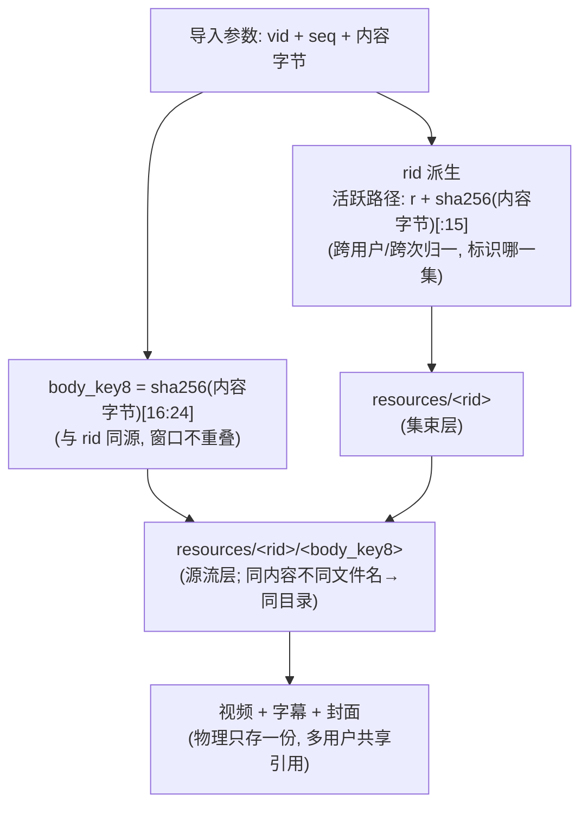
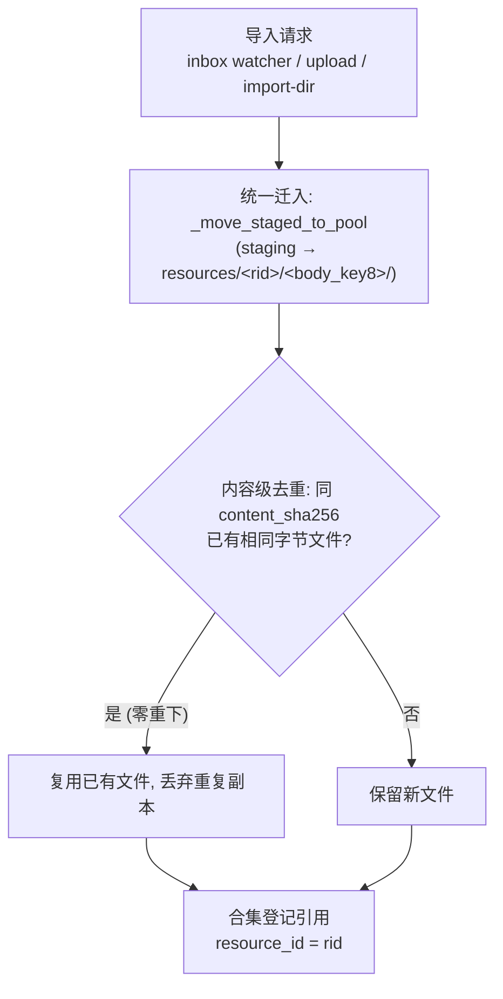
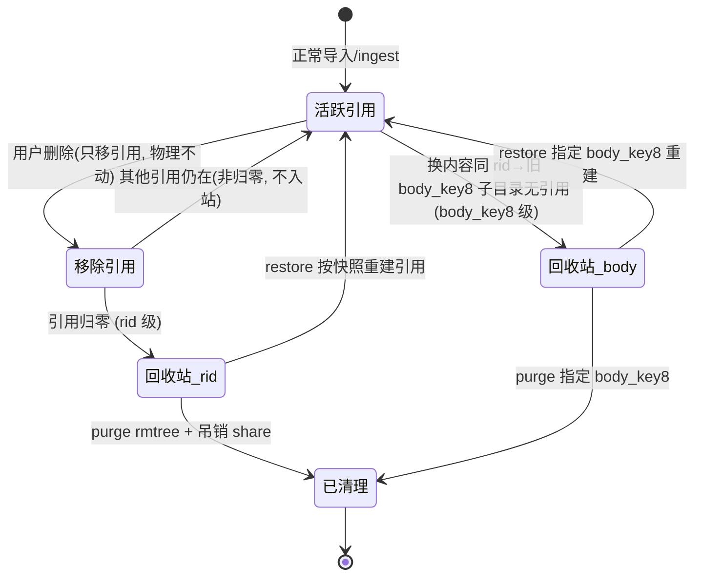

# 媒体资源池与回收站：架构设计与工程实践（对外公开版）

> 本文是 `media-resource-manager`（简称 **RM**）的公开架构文档，面向想要了解或复用该设计的开发者。
> 它描述 RM 作为「媒体资源管理后端」的核心模型：**内容级去重、双层回收站（物理保留可恢复）、合集引用、按身份隔离的共享失效、可插拔认证**。
> 内部版（含部署拓扑与变更记录）不随开源发布；本文已做脱敏与口径校准。
> 注：文中的 mermaid 图在 GitHub / Gitee 上可正常渲染；若发布到微信公众号需先预渲染为图片（微信不渲染 mermaid）。

---

## 0. 这个项目解决什么问题

个人 / 小团队的媒体资料（视频、字幕、封面）往往面临三个痛点：

1. **重复囤积**：同一内容被不同渠道、不同时间多次导入，文件名/清晰度不同就落两份，磁盘被悄悄吃满。
2. **删了找不回**：误删后只能从备份恢复，或干脆丢失；而"直接删物理文件"又容易误伤仍在被引用的资源。
3. **共享失控**：把一条资源分享给别人后，自己一删，对方链接立刻失效却毫无提示；或者反过来，想收回授权却收不干净。

RM 的设计目标就是：**让"导入即去重、删除可恢复、共享可管控"成为系统默认行为**，而不是靠人工纪律维持。

---

## 1. 架构总览：获取层与管理层解耦

RM 在演进早期是一个单体（既下载又管理）。后来拆成两层，通过一个**共享 inbox 目录 + 每组的 `{stem}.meta.json` 文件锚点**解耦，两侧无代码耦合：

| 层 | 项目代号 | 职责 |
|---|---|---|
| 获取层 | `video_download`（简称 `dl`） | 负责下载、解析、字幕 OCR 编排；产出「视频 + 字幕 + 封面 + meta 四件套」投递到共享 inbox |
| 管理层 | `rm_app`（即 RM 本体） | 资源池、合集引用、回收站、文章衍生物、封面缓存、共享令牌 |

**解耦契约**：获取层只把四件套 staging 到本地 inbox，不直接挂载资源池盘；RM 通过一个轻量 watcher 主动拉取。这样两层可以独立部署、独立迭代——获取层甚至可以是任意能产出同构四件套的生产者。

```
共享 inbox/
├── {stem}.mp4            # 视频（必需）
├── {stem}_字幕.txt       # 主字幕（RM 的 match_subtitle 契约只认此后缀）
├── {stem}.jpg            # 封面（与视频同 stem）
└── {stem}.meta.json      # 组锚：title / vid / seq / target_cid / owner?
```

> 部署形态上，RM 通常以容器或常驻进程运行，bind 挂载宿主的「资源数据目录」「inbox 目录」；获取层与 RM 各自独立，仅通过 inbox 目录交换数据。具体宿主机路径、网络拓扑属于部署细节，本文不展开。

---

## 2. 可插拔认证（三态）

RM 内置三种认证模式（由配置 `auth_mode` 切换），同一份代码既可挂在权限网关后，也可完全独立运行：

| 模式 | 语义 |
|---|---|
| `gateway` | 只采信可信代理注入的 `X-User-Email`；RM 不存密码、不引导管理员（生产环境挂在权限网关后即用此态） |
| `auto`（默认） | 过渡桥：可信 email > `X-Session-Id` > 匿名 |
| `standalone` | RM 自带账号体系（`/api/login` + 本地账号文件 + 管理员引导 + 用户管理），脱离网关可独立部署、多用户并行 |

> 这一设计让 RM 既能作为"大系统的一个下游服务"被网关统一鉴权，也能作为"一个独立小工具"被直接部署，无需引入额外组件。

---

## 3. 资源池物理布局与两层去重 key

```
downloads/
├── resources/<rid>/<body_key8>/<文件>   # 资源本体库（内容级去重核心）
├── _collections/collections.json        # 合集（按身份分桶）
├── _articles/users/<hash>/             # 共享文章衍生物（弱关联，存于 RM 侧）
└── .thumbnail_cache/                    # 本地封面缓存（md5(内容)[:12]+ext）
```

- **rid（资源主键，集束层）**：标识「哪一集」。活跃入池路径由**内容哈希**派生 `rid = r + sha256(内容字节)[:15]`，跨用户 / 跨次归一，去重强度最高。
  - 为兼容历史与异常条目，`_add_to_collection`（写合集引用的唯一入口）保留一个**确定性兜底**：当条目未显式携带 `resource_id` 时，按 `(vid, seq)` 派生 rid。两套方案并存，但生产数据统一走内容哈希，rid 与池目录命名一致，不会出现"条目 rid ≠ 池目录 rid"导致取流 404 的错配。
- **body_key8（本体键，源流层）**：取同一内容哈希的 `[16:24]` 窗口，**与 rid 同源、窗口不重叠**。
  - 同内容、不同文件名 → 落入同一 `<body_key8>` 子目录（内容级去重）；
  - 不同画质（内容不同）→ 不同 `<body_key8>` 子目录，各自存档，符合「画质不去重」语义。
- `vid|seq` 仍用于**合集去重键** `(vid, 序号, 标题)`（序号取文件名前缀 `NNN`），用于识别"同一集被重下到不同目录"，避免媒体库条目翻倍。



---

## 4. 入池路由：零重下 + 内容级去重

入池逻辑（`_ingest_into_pool`，被 upload / import-dir / ingest API / inbox watcher 共用）的决策路径是：

1. **无条件先把 staging 迁入资源池**（`_move_staged_to_pool`），不存在"池里命中就跳过迁入"的早返回分支；
2. 迁入后，在 `resources/<rid>/<body_key8>/` 内按 `content_sha256` 做**字节级**去重——若已有完全相同内容的文件，则复用已有文件、丢弃刚迁入的重复副本（附加物如字幕/封面仍正常迁入）。



**功能结果等价于"池命中即引用"**：同内容只存一份、跨用户 / 跨次零重下；但实现上是"先迁入再删重"，更稳妥、不会因命中判断失误漏迁。

---

## 5. 导入通道与 inbox 契约

| 通道 | 语义 | 状态 |
|---|---|---|
| **inbox watcher** | **移动语义 · 处理即清 · 失败重试** | 自动目录导入的唯一定期通道 |
| `/api/import-dir` | **复制语义 · 源不动** | 一次性运维工具（带护栏：跳过处理中/失败文件、排除 meta、不抢 watcher 的活） |
| `/api/upload` | 手动上传 | 保留 |

三通道共用 `_ingest_into_pool`，去重 / 引用 / 回收逻辑天然一致。

**inbox 四件套契约**（`{stem}.meta.json` 为组锚，组内文件原子入池）：
- **字幕双写**：获取端投递 `txt`（主字幕）+ `srt`（增强）双份，watcher 一并收集入池；
- **封面三源兜底**：缓存文件名直取 / URL 前缀匹配现场下载 / 空时回源平台详情接口取封面再抓，全失败才降级；
- **meta 不写 owner**：投递端不冒充归属，RM 统一归默认管理员账号（仅 meta 显式带 `owner` 才覆盖）。

### 定向补录（A+B）

watcher / upload 按组锚整组入池后，常有"同 stem 但不在当前组锚内"的伴随文件滞留 inbox（如漏投的 `.srt`、后补封面）。补录机制按 `rid` 绑定 + 可视化：
1. pending 登记：入池后扫描 inbox 内同 stem 未消费文件，登记为「待补挂」候选；
2. 前端展示「📎待补挂」按钮，列出当前用户的 pending 项；
3. 用户确认后定向补录，把选定文件迁入该 rid 的资源池目录并跨合集回填字段。

> 补录是"入池后"的二次定向绑定，不是新通道；它复用 `_attach_files_into_pool`（与 ingest 同一套迁入 / 回填逻辑），仅作用于已存在的 rid。

---

## 6. 合集引用模型

`_collections/collections.json` 按身份分桶：`{owner: {"collections": [...]}}`。
- 去重键 `(vid, 序号, 标题)`；
- 媒体库条目持有 `resource_id`；取流时校验"该身份合集是否含此 rid"（防越权，否则 404）；
- **删除池文件只移引用、不删物理**；
- 单默认合集 `default` + 系统合集 `__trash__`（回收站）。

---

## 7. 回收站机制（核心亮点）：双层、物理保留、可恢复

这是 RM 区别于"删了就没"或"删了直接 rm"方案的关键。

### 7.1 rid 级回收

删除合集引用 → 全局 **rid 级活跃计数**（遍历所有身份，排除 `__trash__`）→ 归零才入管理员 `__trash__`：
- 物理 `resources/<rid>/` **保留**，条目保留最后引用的真实文件 `rel_path` / `title` / `trashed_from` / `trashed_at`；
- 管理员可列表 / **彻底清理（purge，rmtree + 吊销相关共享）** / **还原（restore，整条快照逐字重建引用）**；
- 引用复活即清回收站：`_add_to_collection` 每处登记引用都接 `remove_trash_entry(rid)`，杜绝"活跃引用"与"回收站条目"矛盾。

### 7.2 body_key8 级回收（换内容的孤儿清理）

**问题**：换内容是"同 rid 多 body_key8 子目录"；旧子目录因 rid 仍被新条目引用（指向新目录）导致 rid 级回收永不触发 → 旧文件成孤儿（此前只能人工扫删）。

**方案（自动，优于运维 sweep）**：`_ingest_into_pool` 末尾调 `_recycle_unreferenced_body_dirs(rid, keep_body_key8)`，扫描同 rid 下除保留项外的子目录，对每个判定"是否有任一活跃条目的 `rel_path` 指向该子目录内主媒体"；无引用 → 登记**带 `body_key8` 维度**的回收项（物理保留、可恢复、绝不直接删）。`trash_list` / `purge` / `restore` 全部 `body_key8` 精确化，避免 purge 误删仍活跃的新版本内容。



**原则**：restore 类操作一律整条快照还原，不做"最小字段重建"——字段清单会演进，重建必漏。

---

## 8. 按身份的共享失效模型

共享令牌的生死只看一件事：**发布者本人"正常合集"（排除 `__trash__`）是否还持有该 rid 的活跃引用**，与全局引用是否归零、资源是否停在管理员回收站均无关。

- 发布者删除自身引用 → 令牌 `revoked + locked`，**不可重置开启**（重新开启直接 409 拒绝）；
- 重置闸门 = 发布者把资源恢复到自己正常合集（`trash_restore` 清 `locked`，仍须手动重开）；
- 令牌结构增 `locked` 字段，配套 `_owner_has_active_ref` / `_lock_owner_shares` / `_unlock_owner_shares`；
- 文章衍生物立场：系统仅做生成时的字幕路径弱关联，purge 默认保留文章 `.md`，不无差别删除。

> 这让"分享出去的资源"与"发布者的真实持有状态"强绑定——发布者误删会立刻、可预期地让分享失效，而非悄悄裂开或悄悄续命。

---

## 9. 字幕与封面

- **字幕（多格式入池）**：获取端 `txt + srt` 双写；入池时 `.txt` 优先绑主字幕（match_subtitle 契约仅认 `_字幕.txt`），`.srt` 作为增强记录 `subtitle_srt` 并物理入池。前端仅在有 `subtitle_srt` 时显示"带时间轴字幕"按钮。
- **封面（缓存名回填）**：入池时把封面图复制进 `.thumbnail_cache/`，以 `md5(内容)[:12]+ext` 缓存名回填 `cover` 字段（前端只认 `/api/thumbnail-cache/{缓存名}`，写相对路径会 404）。
- **消费侧**：分享页可无鉴权复用封面缓存下载；`detach` 端点支持用户二次确认后的定向物理删除（字幕/封面，不含主媒体），与"删除只移引用"的默认语义形成显式例外，二者并存。
- **换封面自动清旧**：补挂新封面后自动清理池内未被保留的旧封面文件，不残留旧图。

---

## 10. 配置项（RM 侧，部署时注入）

| 键 | 说明 |
|---|---|
| `RM_INBOX_DIR` | watcher 轮询目录 |
| `RM_INBOX_POLL_SEC` | 轮询周期（如 10s） |
| `RM_INBOX_DEFAULT_OWNER` | 入池默认归属（默认管理员账号） |
| `RM_INBOX_MAX_RETRY` | 失败前重试上限 |
| `thumbnail_cache_dir` | 封面缩略图目录（须指向资源数据目录下的 `.thumbnail_cache`） |

> 实现注意（踩坑沉淀）：改**任何**公共函数签名，须全仓库搜调用点（主模块 + 旁路 watcher + 测试脚本），只查主模块必漏；watcher 收尾会 `rmtree` 处理目录，凡未显式作为附加物传入的文件会被物理删除——新增入池字段时，调用方必须同步把所有要保留的文件塞进附加物列表。

---

## 11. 状态清单（能力落地）

| 编号 | 项 | 状态 |
|---|---|---|
| O1 | 清理 RM 侧下载缓存死逻辑 | ✅ |
| O2 | 三导入通道分工护栏 | ✅ |
| O3 | `body_key8` 内容派生 + 内容级去重 + 存量迁移 | ✅ |
| O4 | 文章系统断层 | ✅ 决策降级（走"重新生成"路径） |
| O5 | 身份体系双轨 | ✅ 决策降级（inbox 统一归默认管理员） |
| O6 | OCR 编排与资源池耦合边界 | ✅ 天然满足（获取端无 OCR） |
| O7 | 多用户并发回收站 / 共享健壮性 | ✅ 已验证（单进程压测全 PASS；多 worker 靠跨进程 flock / 单 worker 约束兜底） |
| O8 | 部署暴露收口 | ✅ |
| O9 | 设计文档更新 | ✅ |
| R8 | 投递 inbox 端到端 | ✅ |
| R9 | 封面链路双 bug 修复 | ✅ |
| R1 | 多字幕 / 附加物入池 | ✅ |
| R2 | 换内容旧版本进回收站 | ✅ |
| R3 | ingest 返回 `replaced_rel_path` | ✅ |
| A+B | 定向补录入口（pending 可视化 + 按 rid 绑定） | ✅ |
| 缺口1 | 分享页封面下载 | ✅ |
| 缺口3 | detach 定向删除 + 换封面自动清旧 | ✅ |
| — | 身份与认证模式 standalone（自带账号） | ✅ |

---

## 12. 关于开源与部署的说明（中性）

- RM 的开源价值集中在**管理层模型**（资源池、去重、回收站、合集、共享失效、可插拔认证），这部分与具体获取端解耦，可独立复用。
- 获取层 `video_download` 是另一套私有组件，负责把外部媒体转化为本文的"四件套"投递给 RM。开源 RM 时，只需约定好 inbox 四件套契约，获取端可用任意生产者替代（也可不接获取端，直接用手动上传 / import-dir）。
- 部署上，RM 以容器或常驻进程运行，bind 挂载资源数据目录与 inbox 目录即可；认证建议生产环境挂在权限网关后以 `gateway` 模式运行，或独立以 `standalone` 模式运行。

*本文为对外公开版；内部版（含部署拓扑与逐日变更记录）不随开源发布。*
