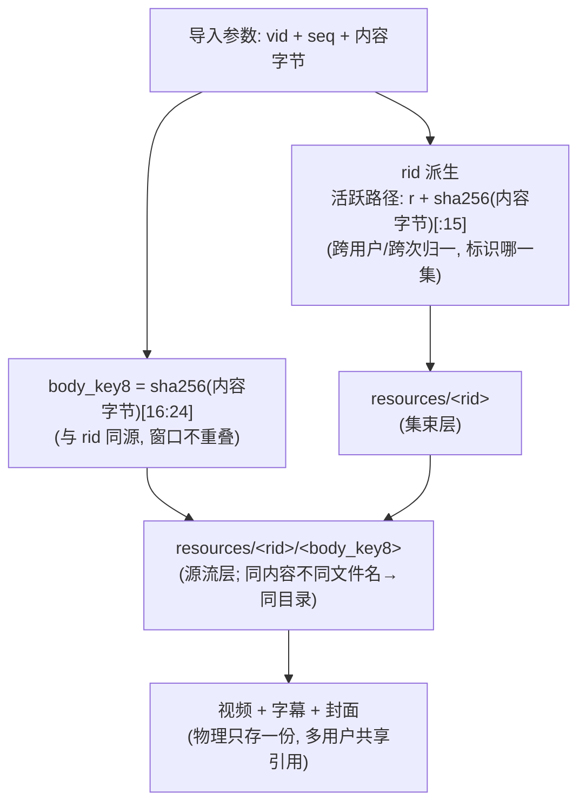
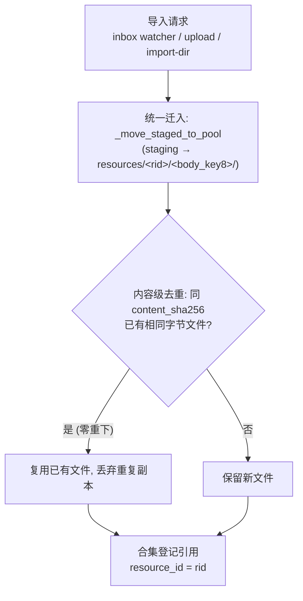
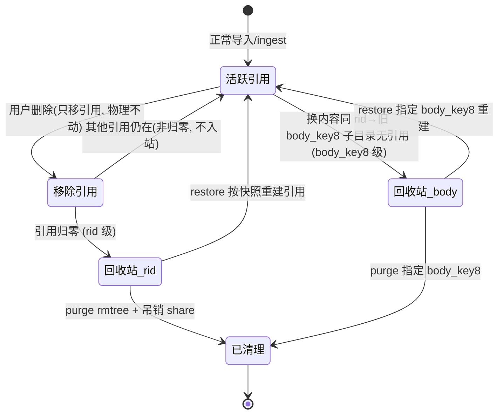

# 媒体资源池与回收站：导入即去重、删除可恢复的媒体管理后端

> 本文是开源项目 `media-resource-manager`（简称 RM）的架构文档，面向想了解或复用该设计的开发者。RM 是一个媒体资源管理后端，围绕四项能力构建：**内容级去重、双层回收站（可恢复）、合集引用、按身份隔离的共享失效**，并支持可插拔认证。

---

## 0. 这个项目解决什么问题

个人 / 小团队的媒体资料（视频、字幕、封面）往往面临三个痛点：

1. **重复囤积**：同一内容被不同渠道、不同时间多次导入，文件名/清晰度不同就落两份，磁盘被悄悄吃满。
2. **删了找不回**：误删后只能从备份恢复，或干脆丢失；而"直接删物理文件"又容易误伤仍在被引用的资源。
3. **共享失控**：把一条资源分享给别人后，自己一删，对方链接立刻失效却毫无提示；或者反过来，想收回授权却收不干净。

RM 的设计目标是让「导入即去重、删除可恢复、共享可管控」成为系统默认行为，而非依赖人工纪律维持。

---

## 1. 架构总览：获取层与管理层解耦

RM 拆成两层，通过一个**共享 inbox 目录 + 每组的 `{stem}.meta.json` 文件锚点**解耦，两侧无代码耦合：

| 层   | 项目代号                      | 职责                                                       |
| --- | ------------------------- | -------------------------------------------------------- |
| 获取层 | `video_download`（简称 `dl`） | 负责下载、解析、字幕 OCR 编排；产出「视频 + 字幕 + 封面 + meta 四件套」投递到共享 inbox |
| 管理层 | `rm_app`（即 RM 本体）         | 资源池、合集引用、回收站、文章衍生物、封面缓存、共享令牌                             |

**解耦契约**：获取层只把四件套 staging 到本地 inbox，不直接挂载资源池盘；RM 通过一个轻量 watcher 主动拉取。这样两层可以独立部署、独立迭代——获取层甚至可以是任意能产出同构四件套的生产者。

```
共享 inbox/
├── {stem}.mp4            # 视频（必需）
├── {stem}_字幕.txt       # 主字幕（RM 的 match_subtitle 契约只认此后缀）
├── {stem}.jpg            # 封面（与视频同 stem）
└── {stem}.meta.json      # 组锚：title / vid / seq / target_cid / owner?
```

部署形态：RM 通常以容器或常驻进程运行，bind 挂载宿主的「资源数据目录」「inbox 目录」；获取层与 RM 各自独立，仅通过 inbox 目录交换数据。

---

## 2. 可插拔认证（三态）

RM 内置三种认证模式（由配置 `auth_mode` 切换），同一份代码既可挂在权限网关后，也可完全独立运行：

| 模式           | 语义                                                              |
| ------------ | --------------------------------------------------------------- |
| `gateway`    | 只采信可信代理注入的 `X-User-Email`；RM 不存密码、不引导管理员（生产环境挂在权限网关后即用此态）       |
| `auto`（默认）   | 过渡桥：可信 email > `X-Session-Id` > 匿名                              |
| `standalone` | RM 自带账号体系（`/api/login` + 本地账号文件 + 管理员引导 + 用户管理），脱离网关可独立部署、多用户并行 |

> 这一设计让 RM 既能作为"大系统的一个下游服务"被网关统一鉴权，也能作为"一个独立小工具"被直接部署，无需引入额外组件。

---

## 3. 资源池物理布局与两层去重 key

```
downloads/
├── resources/<rid>/<body_key8>/<文件>   # 资源本体库（内容级去重核心）
├── _collections/collections.json        # 合集（按身份分桶）
├── _articles/users/<hash>/             # 共享文章衍生物（弱关联，存于 RM 侧）
└── .thumbnail_cache/                    # 本地封面缓存（md5(内容)[:12]+ext）
```

- **rid（资源主键，集束层）**：标识「哪一集」。活跃入池路径由内容哈希派生 `rid = r + sha256(内容字节)[:15]`，跨用户 / 跨次归一，去重强度最高（`_add_to_collection` 在条目未显式携带 `resource_id` 时按 `(vid, seq)` 兜底派生，仅作兼容）。为避免「条目 rid ≠ 池目录 rid」导致取流 404，rid 与池目录命名保持一致。
- **body_key8（本体键，源流层）**：取同一内容哈希的 `[16:24]` 窗口，与 rid 同源、窗口不重叠。
  - 同内容、不同文件名 → 落入同一 `<body_key8>` 子目录（内容级去重）；
  - 不同画质（内容不同）→ 不同 `<body_key8>` 子目录，各自存档，符合「画质不去重」语义。
- `vid|seq` 用于**合集去重键** `(vid, 序号, 标题)`（序号取文件名前缀 `NNN`），识别「同一集被重下到不同目录」，避免媒体库条目翻倍。

注意：以上是两层去重——rid 管物理层内容唯一（池里同一内容只存一份），合集去重键管媒体库条目不翻倍，二者并存不冲突。



---

## 4. 入池路由：先迁入再字节级去重

入池逻辑（`_ingest_into_pool`，被 upload / import-dir / ingest API / inbox watcher 共用）：

1. **统一先把 staging 迁入资源池**（`_move_staged_to_pool`）；
2. 迁入后，在 `resources/<rid>/<body_key8>/` 内按 `content_sha256` 做**字节级**去重：同内容只物理保留一份（附加物如字幕/封面照常迁入）。



**结果**：同内容只存一份、跨用户 / 跨次零重下；三通道共用 `_ingest_into_pool`，去重 / 引用 / 回收逻辑天然一致。

---

## 5. 导入通道与 inbox 契约

| 通道                | 语义                     | 状态                                            |
| ----------------- | ---------------------- | --------------------------------------------- |
| **inbox watcher** | **移动语义 · 处理即清 · 失败重试** | 自动目录导入的唯一定期通道                                 |
| `/api/import-dir` | **复制语义 · 源不动**         | 一次性运维工具（带护栏：跳过处理中/失败文件、排除 meta、不抢 watcher 的活） |
| `/api/upload`     | 手动上传                   | 保留                                            |

**inbox 四件套契约**（`{stem}.meta.json` 为组锚，组内文件原子入池）：

- **字幕双写**：获取端须同时投递 `txt`（主字幕）与 `srt`（增强）两份；
- **封面随组投递**：封面图随组锚一并给出，获取端负责取到（缓存名直取 / URL 下载 / 回源平台详情接口），全失败才降级；
- **meta 不写 owner**：投递端不冒充归属，RM 统一归默认管理员账号（仅 meta 显式带 `owner` 才覆盖）。

### 定向补录（A+B）

watcher / upload 按组锚整组入池后，常有"组锚之外"的伴随文件滞留 inbox（如晚到的 `.srt`、文件名对不上视频的后补封面）。RM 用"自动补挂 + 人工定向补录"两级机制收这个尾巴：

1. **自动暂存**：衍生物先到、视频未入池（或文件名主干配不上任何已有资源）→ 暂存到 pending 区，登记为「待补挂」候选；
2. **自动补挂**：视频随后入池时，RM 自动从 pending 区捞取同主干的字幕/封面，迁入该 rid 的池目录并回填字段，无需人工干预；
3. **人工定向补录**：配不上的文件（如"封面03.png"），前端「📎待补挂」按钮列出 pending 项，用户指定目标 rid 后迁入该资源池目录并跨合集回填字段。

补录不是新的导入通道：它复用 `_attach_files_into_pool`（与 ingest 同一套迁入/回填逻辑），仅作用于已存在的 rid。

---

## 6. 合集引用模型

`_collections/collections.json` 按身份分桶：`{owner: {"collections": [...]}}`。

- 去重键 `(vid, 序号, 标题)`；
- 媒体库条目持有 `resource_id`；取流时校验"该身份合集是否含此 rid"（防越权，否则 404）；
- **删除池文件只移引用、不删物理**；
- 单默认合集 `default` + 系统合集 `__trash__`（回收站）。
- 引用被移空后由 §7 的回收站链路接管：全局计数归零才物理保留进回收站，而非立即删除。 

---

## 7. 回收站机制：双层、物理保留、可恢复

删除操作默认只移引用、不删物理文件；需要清理时才走回收站，且物理文件始终保留、可还原。

### 7.1 rid 级回收

删除合集引用 → 全局 **rid 级活跃计数**（遍历所有身份，排除 `__trash__`）→ 归零才入管理员 `__trash__`：

- 物理 `resources/<rid>/` **保留**，条目保留最后引用的真实文件 `rel_path` / `title` / `trashed_from` / `trashed_at`；
- 管理员可列表 / **彻底清理（purge，rmtree + 吊销相关共享）** / **还原（restore，整条快照逐字重建引用）**；
- 引用复活即清回收站：`_add_to_collection` 每处登记引用都接 `remove_trash_entry(rid)`，杜绝"活跃引用"与"回收站条目"矛盾。

### 7.2 body_key8 级回收（换内容的孤儿清理）

换内容会产生「同 rid 多 body_key8 子目录」；旧子目录因 rid 仍被新条目引用（指向新目录）而不会触发 rid 级回收。`_ingest_into_pool` 末尾调 `_recycle_unreferenced_body_dirs(rid, keep_body_key8)`，扫描同 rid 下除保留项外的子目录，对每个判定"是否有任一活跃条目的 `rel_path` 指向该子目录内主媒体"；无引用 → 登记**带 `body_key8` 维度**的回收项。`trash_list` / `purge` / `restore` 全部 `body_key8` 精确化，避免 purge 误删仍活跃的新版本内容。



restore 类操作一律整条快照还原，不做"最小字段重建"——字段清单会演进，重建必漏。

---

## 8. 按身份的共享失效模型

共享令牌的生死只看一件事：**发布者本人"正常合集"（排除 `__trash__`）是否还持有该 rid 的活跃引用**，与全局引用是否归零、资源是否停在管理员回收站均无关。

- 发布者删除自身引用 → 令牌 `revoked + locked`，**不可重置开启**（重新开启直接 409 拒绝）；
- 重置闸门 = 发布者把资源恢复到自己正常合集（`trash_restore` 清 `locked`，仍须手动重开）；
- 令牌结构增 `locked` 字段，配套 `_owner_has_active_ref` / `_lock_owner_shares` / `_unlock_owner_shares`；
- 文章衍生物立场：系统仅做生成时的字幕路径弱关联，purge 默认保留文章 `.md`，不无差别删除。

> 这让"分享出去的资源"与"发布者的真实持有状态"强绑定——发布者误删会立刻、可预期地让分享失效，而非悄悄裂开或悄悄续命。

---

## 9. 字幕与封面

- **字幕（多格式入池）**：获取端 `txt + srt` 双写；入池时 `.txt` 优先绑主字幕（match_subtitle 契约仅认 `_字幕.txt`），`.srt` 作为增强记录 `subtitle_srt` 并物理入池。前端仅在有 `subtitle_srt` 时显示"带时间轴字幕"按钮。
- **封面（缓存名回填）**：入池时把封面图复制进 `.thumbnail_cache/`，以 `md5(内容)[:12]+ext` 缓存名回填 `cover` 字段（前端只认 `/api/thumbnail-cache/{缓存名}`，写相对路径会 404）。
- **消费侧**：分享页可无鉴权复用封面缓存下载；`detach` 端点支持用户二次确认后的定向物理删除（字幕/封面，不含主媒体），与"删除只移引用"的默认语义形成显式例外，二者并存。
- **换封面自动清旧**：补挂新封面后自动清理池内未被保留的旧封面文件，不残留旧图。

---

## 10. 配置项（RM 侧，部署时注入）

| 键                        | 说明                                      |
| ------------------------ | --------------------------------------- |
| `RM_INBOX_DIR`           | watcher 轮询目录                            |
| `RM_INBOX_POLL_SEC`      | 轮询周期（如 10s）                             |
| `RM_INBOX_DEFAULT_OWNER` | 入池默认归属（默认管理员账号）                         |
| `RM_INBOX_MAX_RETRY`     | 失败前重试上限                                 |
| `thumbnail_cache_dir`    | 封面缩略图目录（须指向资源数据目录下的 `.thumbnail_cache`） |

---

## 11. 能力清单（当前落地状态）

| 能力 | 说明 |
| --- | --- |
| 内容级去重 | `rid` + `body_key8` 双 key；同内容跨用户/跨次只物理存一份，不同画质分别存档 |
| 双层回收站 | rid 级（引用归零入站）+ body_key8 级（换内容孤儿清理）；物理保留、整条快照还原、purge 精确到版本 |
| 合集引用 | 按身份分桶；删除只移引用；取流校验归属防越权 |
| 共享失效 | 共享令牌与发布者持有状态强绑定：删除即 `revoked + locked` 不可重置，还原后手动重开 |
| 可插拔认证 | `gateway` / `auto` / `standalone` 三态，同一份代码独立部署或挂网关皆可，切换无需迁移数据 |
| 导入通道 | inbox watcher（自动）、`/api/import-dir`（运维）、`/api/upload`（手动）、`/api/ingest`（外部生产者） |
| 定向补录 | 滞留 inbox 的伴随文件自动暂存/自动补挂，配不上的由人工按 rid 补挂 |
| 并发健壮性 | 原子写 + 跨进程文件锁 + 事务入口缓存失效；单进程/多进程压测验证（Linux 真机） |

---

## 12. 开源与部署

- RM 的开源价值集中在**管理层模型**（资源池、去重、回收站、合集、共享失效、可插拔认证），这部分与具体获取端解耦，可独立复用。
- 获取层 `video_download` 是另一套私有组件，负责把外部媒体转化为本文的"四件套"投递给 RM。部署 RM 时，只需约定好 inbox 四件套契约，获取端可用任意生产者替代（也可不接获取端，直接用手动上传 / import-dir）。
- 部署上，RM 以容器或常驻进程运行，bind 挂载资源数据目录与 inbox 目录即可；认证建议生产环境挂在权限网关后以 `gateway` 模式运行，或独立以 `standalone` 模式运行。

---

## 快速上手

```bash
git clone https://github.com/wzh-miscnotes/media-resource-manager.git
cd media-resource-manager
pip install -r requirements.txt
cp config.example.json config.json    # 默认值即可跑，按需调整
python run_server.py                  # 前端 + API 同域托管，默认 0.0.0.0:5006
```

浏览器访问 `http://localhost:5006` 即可使用。`standalone` 认证模式下首次启动会引导创建管理员账号（环境变量 `RM_ADMIN_PASSWORD` 未设置时自动生成随机密码并打印到日志）。Docker 部署可直接使用仓库自带的 `Dockerfile`（Python 3.11 + ffmpeg）。

---

## 仓库地址

本项目以 **Apache-2.0** 协议开源，仓库地址：

- Gitee：`https://gitee.com/Wuzhenhong/media-resource-manager`
- GitHub：`https://github.com/wzh-miscnotes/media-resource-manager`

如果这套「资源池 + 双层回收站 + 合集引用」的管理层模型对你有参考价值，欢迎 Star / Fork / Issue 交流。
