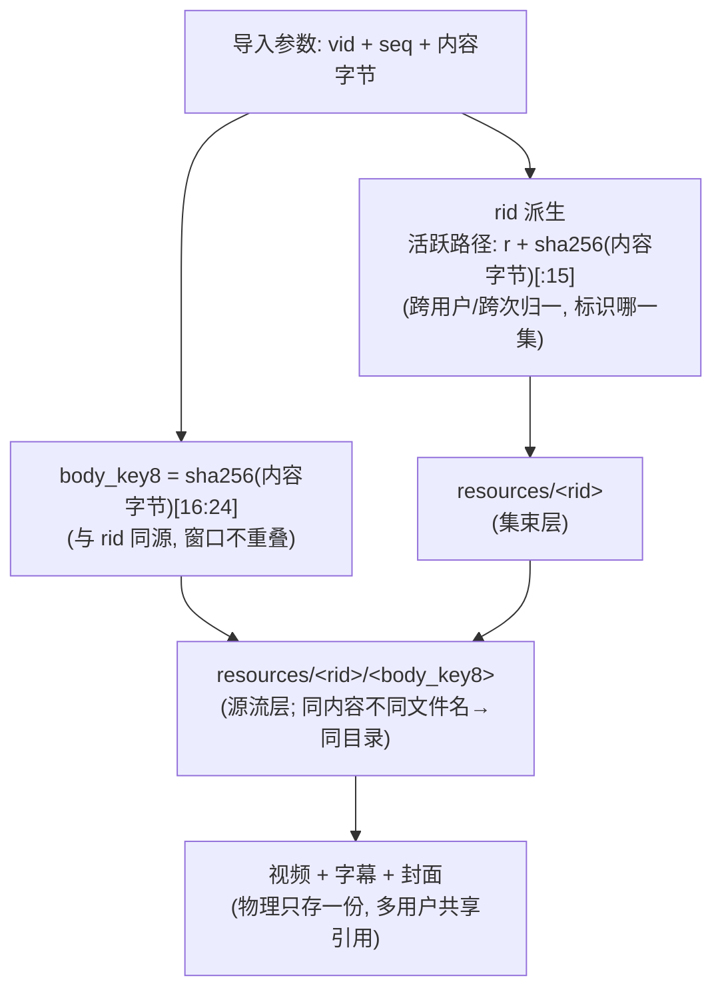
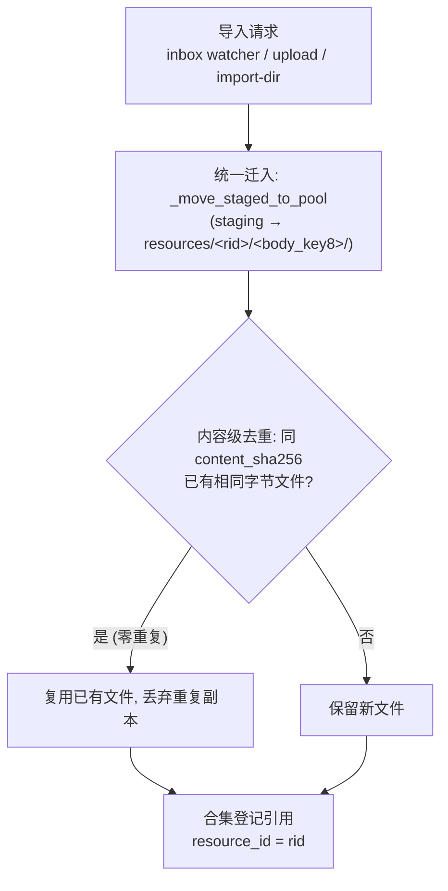
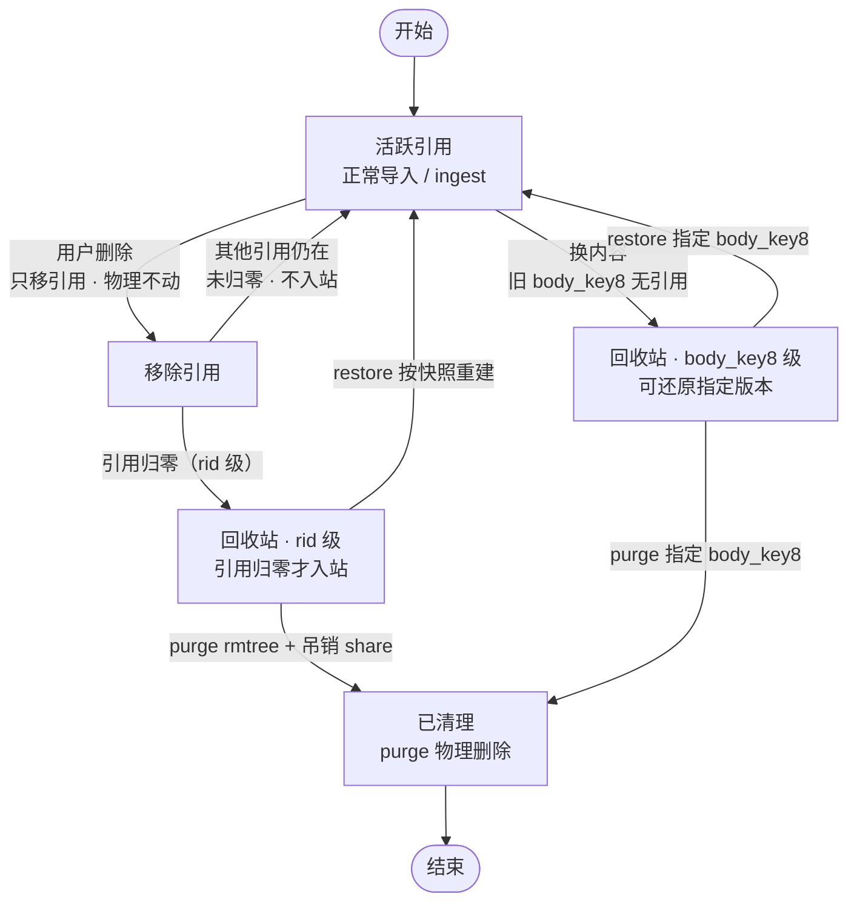

# 资源池与回收站设计

本文与 `app.py` 当前实现一致，是 RM 资源池、去重、回收站、共享失效的权威说明。历史演进见 git 记录。

早期 v1 基准中「`body_key8` 由文件名与大小派生」「`DL_CACHE` 三级入池路由」「封面缓存按 URL 命名」等描述均已作废，不要作为依据。

## 1. 物理布局

```
<downloads_dir>/                            # config.downloads_dir
├── resources/<rid>/<body_key8>/<文件>       # 资源本体库（双层去重）
├── _collections/collections.json           # 合集（按 owner 分桶）
├── _articles/users/<hash>/                 # 共享文章衍生物（弱关联）
└── .thumbnail_cache/                       # 封面缓存（config.thumbnail_cache_dir）
```

- `collections.json` 结构：`{owner: {"collections": [...]}}`，owner 即身份串。
- 系统合集 `__trash__` 挂在 `admin@local` 下，标记 `system: true`，是回收站暂存区。

## 2. 双层去重：rid 与 body_key8

两者都从**同一个内容 sha256** 派生，窗口不重叠：

| 键 | 取值 | 作用层 | 含义 |
| --- | --- | --- | --- |
| `rid` | `"r" + sha256[:15]` | 集束层 | 标识「哪一集 / 哪一个资源束」 |
| `body_key8` | `sha256[16:24]` | 源流层 | 标识「该资源束下的哪一个内容版本」 |



`rid` 的输入分两种：

- **外部来源（有 `vid` / `seq`）**：`sha256(f"{vid}|{seq}")[:15]`，同一集跨用户、跨次导入天然归一，不含标题（`_resource_id_for`）。
- **本地文件（无 `vid`）**：直接对文件字节取 `sha256`，`rid = "r" + h[:15]`，`body_key8` 取同一哈希的 `[16:24]`（upload、import-dir 均如此）。

**为什么改成内容派生**：早期 `body_key8 = sha256(文件名|大小)[:8]` 与内容无关，同一份内容换个文件名就会在池里落两份。改绑定内容后，同内容必定落到同一个 `body_key8` 目录，入池即可去重。

⚠️ 派生公式在 `app.py`、`inbox_watcher.py`、`scripts/migrate_body_key8.py` 三处必须保持一致，改动要同步三处。

入池时还会做**字节级**兜底：`_find_identical_media` 在池目录内按 `content_sha256` 扫描，命中已有主媒体则复用，不存第二份。

## 3. 三通道入池

三个通道共用 `_ingest_into_pool`，去重、引用、回收逻辑天然一致。

| 通道 | 语义 | 定位 |
| --- | --- | --- |
| **inbox watcher** | 移动语义 · 处理即清 | 自动目录导入的定期通道，常驻线程轮询 `RM_INBOX_DIR` |
| **`/api/import-dir`** | 复制语义 · 源目录不动 | 一次性运维 / 迁移工具 |
| **`/api/upload`** | 手动上传 | 前端上传入口 |



watcher 以 `{stem}.meta.json` 为组锚识别「视频 + 字幕 + 封面 + meta」四件套：整组先 move 到 `inbox/.processing/{stem}/` 再入池（半组保护），异常则留在 `.processing` 下轮重试，超过 `RM_INBOX_MAX_RETRY` 移入 `.failed/`，单组失败不阻塞后续组。

⚠️ 不要对 inbox 目录调用 `/api/import-dir`：inbox 由 watcher 独占，误用会扫到 `.processing` / `.failed` 里的半组或失败隔离文件。

### ingest API

```
POST /api/ingest
Body:   { user, rid, body_key8, staged_path, title, subtitle_path?, cover? }
返回:   { ok, rid, resource_id, dedup_hit, rel_path, replaced_rel_path }
```

- `dedup_hit`：池内已有完全同内容的主媒体，本次只加引用、不落新文件。
- `replaced_rel_path`：换内容场景下被替换掉的旧版本路径，无替换则为空串（R3，2026-10-21）。

生产者只把四件套 staging 到本地临时区，不直接挂资源池盘，耦合最低。

## 4. 合集引用模型

- 媒体库条目持 `resource_id`（= `rid`）与 `rel_path`（具体到文件）。
- 取流时校验该身份的合集是否含此 `rid`，不在则 404（防越权）；`__trash__` 不计入可播放范围。
- **删除默认只移引用，不动物理文件**。
- 衍生物（字幕 / 封面 / meta）支持补挂：先按文件名主干同 stem 自动配对；配不上先进 `pending` 暂存，待视频入池后自动补挂；仍配不上则由前端「📎待补挂」指定目标 `rid` 人工定向补录（`POST /api/resource/{rid}/attach`）。
- 反向操作 `POST /api/resource/{rid}/detach` 删除字幕或封面：清字段 + 清池内文件，**不可恢复**，与「删除只移引用」的默认语义是显式例外。
- 更换封面时自动清理池内未被保留的旧封面文件，不残留孤儿。

## 5. 双层回收站



引用归零才入站，物理文件一律保留，由 purge 显式清理。

| 层级 | 计数方式 | 触发场景 |
| --- | --- | --- |
| **rid 级** | `count_active_refs`：遍历所有 owner 合集（排除 `__trash__`）统计 `resource_id == rid` | 该资源束无任何活跃引用 |
| **(rid, body_key8) 级** | `_count_active_refs_body`：按 `rel_path` 前缀 `resources/<rid>/<body_key8>/` 匹配 | 换内容后旧版本子目录不再被任何条目引用 |

回收站条目去重键是 `(resource_id, body_key8)`，因此 rid 级条目（`body_key8` 为空）与「某旧版本」条目互不冲突，换内容产生的旧版本不会被误判为已存在而跳过。

**restore 必须整条快照还原**：`ensure_trash_entry` 存 `entry["item_snapshot"] = dict(item)`，`trash_restore` 按快照逐字还原 `cover` / `subtitle` / `vid` / `subtitle_source` / `duration` 等字段；旧条目无快照才退回最小字段。字段清单会演进，最小字段重建必漏——恢复后封面丢失、字幕绑定丢失都源于此。

引用复活（新增引用或 restore）调 `remove_trash_entry(rid, body_key8=None)`：不传 `body_key8` 是旧语义（移除该 rid 下所有条目），传入则精确移除指定版本，避免误删同 rid 的其他版本。

| 端点 | 行为 |
| --- | --- |
| `GET /api/trash` | 回收站列表（admin） |
| `POST /api/trash/restore` | 按快照还原，默认回写 `trashed_from`，admin 可改派 `target_sid` |
| `POST /api/trash/purge` | `rmtree` 物理删除 + 吊销同 rid 的 share；文章衍生物默认保留 |

## 6. 共享与失效

`GET /share/{token}` 返回单页应用，分享页可无鉴权读取封面缓存与媒体流（standalone 模式下列入公开入口）。

**失效只看发布者本人**：令牌生死取决于发布者自己的正常合集（排除 `__trash__`）是否仍持有该 `rid` 活跃引用，与全局 refcount 是否归零、资源是否停在 admin 回收站都无关。

- 发布者删除自身引用后不再持有该 rid → 其签发的令牌置为 `revoked + locked`，`share_reactivate` 直接 409 拒绝，不可重置开启。
- 重置闸门：发布者把资源恢复到自己的正常合集（`trash_restore` 清 `locked`），之后仍须手动 reopen。
- 令牌结构含 `locked` 字段；`_resolve_share` 拒绝 locked 令牌；`delete_files` 按 owner 加锁。

## 7. 认证与身份

`auth_mode` 三档，决定 `current_identity` 如何解析请求归属：

| 模式 | 行为 |
| --- | --- |
| `standalone` | 只认 RM 自己下发的会话 cookie（`rm_session`），**忽略** `X-User-Email`；身份串一律 `<name>@local` |
| `gateway` | 只认网关注入的 `X-User-Email`，**且仅当来源 IP 处于 `TRUSTED_PROXY_NETS` 内才采信**（防止绕过网关直连伪造身份）；**忽略** `X-Session-Id` |
| `auto`（默认） | 可信 email > 浏览器级 `X-Session-Id` > `None`（落到 `__anon__` 匿名桶） |

生产环境建议挂在权限网关后用 `gateway` 模式，或独立以 `standalone` 模式运行。

## 8. 封面

- 入池时把封面图复制进 `.thumbnail_cache/`，缓存名 `md5(内容)[:12]+ext`，回填入条目的 `cover` 字段。
- 前端只认 `/api/thumbnail-cache/{缓存名}`，直接写资源目录相对路径会 404 显示「无封面」。
- **RM 自身不做任何远端取图**：只接收已落地的本地图片文件（`.jpg` / `.jpeg` / `.png` / `.webp`），投递端如何取得该图不在契约内。

## 9. 相关配置

| 配置项 | 说明 |
| --- | --- |
| `downloads_dir` | 资源数据根目录，池与合集都在其下 |
| `thumbnail_cache_dir` | 封面缓存目录，须指向资源数据目录下的 `.thumbnail_cache` |
| `auth_mode` | `standalone` / `gateway` / `auto` |
| `trusted_proxy_nets` | gateway 模式下可信代理网段，不在其中的 `X-User-Email` 一律忽略 |
| `inbox_dir` | inbox watcher 轮询目录（`RM_INBOX_DIR`） |
